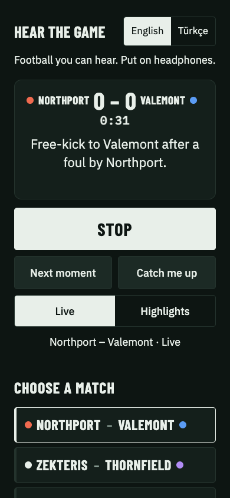
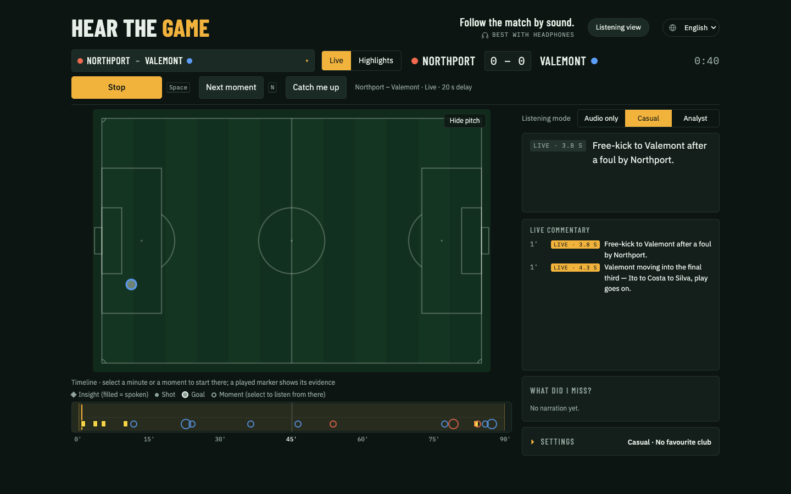
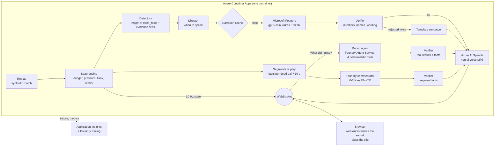

# Hear the Game

**Follow a football match by sound.**

[Live demo](https://ca-engine.proudflower-32a91b05.swedencentral.azurecontainerapps.io/) · Submission category: [Best Use of Microsoft Foundry](#microsoft-stack)

Hear the Game turns a live stream of match events into spatial sound made on your own device, plus short, verified narration in
English or Turkish, so blind and partially sighted fans (and anyone who can't look at a screen) can follow the shape of a match as
it happens.

> Built for the Microsoft × Premier League **Inside the Game** hackathon (October 2026). All teams, players and matches are
> fictional and synthetic: a small league of six clubs and six matches. The default match is **Northport** (red) v **Valemont** (blue).

**Try it**
- Open the live demo with headphones on: left/right position is part of the information.
- The app opens in the **listening view**, built for following the match without looking at the screen; VoiceOver works.
- Press **Start listening** (Space on a keyboard).
- **Show the pitch & data** (or `?view=desk`) opens the broadcast desk with the pitch, timeline, Why card and Analyst mode.

## How it works in 3 steps

1. **Events → sound, at once.** Match events stream to your device, which turns them into spatial sound itself; no model in the way.
2. **Facts → verified words.** Code computes the facts, Microsoft Foundry writes a sentence, the Verifier checks every number and
   name, and Azure AI Speech speaks it.
3. **You choose.** Listening view or desk, Audio only / Casual / Analyst, your club, English or Turkish.

<table>
<tr>
<td width="30%"></td>
<td></td>
</tr>
<tr>
<td>The listening view, the first screen (phone).</td>
<td>The broadcast desk in Casual: pitch, timeline and the live commentary feed.</td>
</tr>
</table>

## Challenge fit

How the app maps to the pipeline in the Official Rules, section 4.1.

| Stage | What Hear the Game does | Where |
|---|---|---|
| Ingest (i a) | A timed match feed (synthetic replay behind an `EventSource` adapter) becomes 10 Hz state: ball, danger, pressure, tempo | [Architecture](#architecture), [`htg/engine/state.py`](htg/engine/state.py) |
| Interpret (i b) | Detectors find pressing surges, tempo drops, flank overloads and fatigue, scored against hidden truth | [Evidence](#evidence), [`htg/engine/detectors.py`](htg/engine/detectors.py) |
| Explain (i c) | Foundry writes each sentence from computed `claim_facts`; the Verifier rejects any number or name not in them | [Why you can trust it](#why-you-can-trust-it) |
| Render (i d) | Spatial sound made on the device, Azure AI Speech voices, pitch and evidence timeline on screen | [What you hear](#what-you-hear) |
| Personalize (i e) | Listening view or desk; Audio only / Casual / Analyst; favourite club; favourite-player chime; EN/TR | [What you hear](#what-you-hear) |
| Player identification, speed (ii) | Player names in callouts and commentary, shot speed in the event log; no auto-eventing from video | [What you hear](#what-you-hear), [Not built](#built-vs-not-built) |
| Narrative generation (iii) | Narration per Insight, a live commentator per segment of play, and the Recap agent for "What did I miss?" and full time | [Recap agent](#recap-agent) |
| Explainability (iv) | Every Insight carries its evidence `seq`s; the Why card shows its facts and lights the evidence on the pitch | [What you hear](#what-you-hear) |
| Data innovation (v) | A synthetic league calibrated on real open data, with hidden scenarios for honest scoring, and a machine-readable feed | [`docs/data.md`](docs/data.md), [Overlay feed](#overlay-feed-machine-readable) |
| Multi-language storytelling (vi) | English and Turkish text and voices from the same facts, each language checked by the Verifier | [Microsoft stack](#microsoft-stack) |

## The problem

Live audio-described commentary for blind and partially sighted fans depends on trained human describers, so it exists for
few matches and few languages. A screen-reader score app tells you the result, not the shape of the game: who is pressing, which
wing is being attacked, whether a player is tiring. Hear the Game tries to give that shape back, by ear, in real time, and to never
say anything the data does not support.

## What you hear

The browser synthesises all match sound itself (Web Audio) from small state packets. Nothing but narration clips is sent as audio.

| Sound | What it means |
|---|---|
| **Ball tick** (about 8 per second, only while the ball is in play) | **Pitch** = danger: higher notes as the ball gets more dangerous (two-octave pentatonic scale driven by an Expected Threat model). **Left/right** = the flank as the attacking team sees it. **Timbre** = which team has the ball (two different waveforms). **Loudness** = tempo. |
| **Heartbeat** (low thump) | Pressure on the ball carrier: starts above a threshold, beats faster and louder as pressure rises. |
| **Crowd** | Filtered noise whose level follows danger. |
| **Event sounds** | Pass: soft click on the ball's side. Shot: rising whoosh. Save: thud. Out or foul: short whistle. Kick-off: long whistle. Half-time: two short whistles; full time: two short and a long one (the clock then shows 90:00 FT). Goal: crowd swell, a rising four-note figure in the scoring team's timbre, whistle. |
| **Favourite club** | Pick one of the six clubs; it applies to every match that club plays (its matches are listed first). Your club's goal gets a brighter, longer crowd swell; a goal against you is short and muted, with no fanfare. The score bar marks "your team" in text, the caption tags narration about your club, and the Director moves your club's Insights one step up the queue. |
| **Favourite player** | Pick a player; a two-note chime plays on the ball's side when they touch it (at most every 3 s). |
| **Narration** | One short sentence (Azure neural voice, EN or TR) when something tactical is detected. Other sound dips to 30% under the voice. The caption shows **verified** (model text that passed the Verifier) or **template** (fallback). |

**When the narrator speaks** (the Director, `htg/engine/director.py`): goals immediately; otherwise never during an attack
(danger ≥ 0.15), never the same kind of Insight for the same team within 5 minutes, one sentence at a time, and only after a
mode-dependent silence (Audio only 10 s, Analyst 15 s, Casual 25 s). Moments of danger are left to the sound: they are not
narrated. **What did I miss?** asks the [Recap agent](#recap-agent) for 2-3 verified sentences about the last 10 minutes, told from
your club's side; at the end of the match it gives a **full-time recap** by itself.

**Listening view (the first screen).** The app opens in a view made for blind and low-vision fans, and for anyone listening rather
than looking: a now-playing card (score, clock and the sentence being spoken), **Start listening**, **Next moment**, **Catch me up**,
Live / Highlights, and the six matches in a list that is always open, so a screen reader swipes straight through it. Tapping a match
starts it; no card shows a final score. It plays in Audio only. **Show the pitch & data** opens the desk described below: it is the
same session, so switching never stops the sound. The view you last used is remembered on the device.

**One language for screen and voice.** One EN/TR switch (in the header; at the top of the listening view) sets the interface and
the commentary together and is remembered on the device. Switched while listening, the commentator follows within the 20 s delay.

**Sound tour.** Before the first start the page offers a 60-second tour: each step plays the real sound (ball tick low to high,
left to right, the two team tones, heartbeat, crowd, pass/shot/save/whistle, goal for and against your club, the favourite-player
chime, the sound dipping under the narrator) with a caption and a short Azure voice line. It never starts the match, Skip stops it
at once, and it is offered until done or skipped.

**Two narrators.** Casual and Audio only hear a **fan**: radio excitement, at most one number, at most 16 words ("Northport are
pressing noticeably harder now, and Valemont are under more pressure."). Analyst hears an **analyst**: the key numbers and the
comparison ("Northport press harder: 39% of Valemont's play is under pressure in the last 5 minutes, 22% earlier on."). Both
come from the same facts and pass the same Verifier.

**Evidence timeline (what you see).** Under the pitch, a strip covers the whole match (0'-90', half-time tick). The match's known
moments (goals, saved shots, cards) show from the start as hollow markers; selecting one (click or Enter) starts 30 s before it,
and a click anywhere on the strip starts from that minute; in Highlights both play the clip at that point and stay in Highlights. A band marks what the session plays. Goals (large ringed dot),
shots (small dot) and Insights (diamond, filled once spoken) appear in club colour as the match plays, with a playhead on the match
clock; those from before your start minute (or between Highlights clips) are drawn at once, as for anyone joining a live match. A new Insight's marker
flashes when it is detected. Every marker is a button with a screen-reader label ("Insight, 21:25, Northport slowing the tempo"). Selecting
one lights up its evidence on the pitch for six seconds: the events (by `seq`) the Insight rests on, the flank band a flank overload
counted, or a shot's position with a line to goal. The **Why** card shows the sentence (verified or template, and whether it was
spoken), the `claim_facts` it was allowed to use, and how many events back it (the Why card is hidden in Audio only).

**Analyst view.** Analyst adds a team stats table (possession, shots on target, pass completion, pressing, corners, fouls; whole
match or last 10 minutes), updated every 10 s of match time from the same `get_stats` tool the [Recap agent](#recap-agent) calls, so
the table and the agent never disagree. The event log shows shot speed and outcome ("Shot · Arda · 72 km/h · blocked") and passes
longer than 30 m with their length. Casual and Audio only stay simple: no table.

**Live commentary (Casual and Audio only).** Tactical narration alone speaks about once every few minutes, so the fan modes add
two layers in a male commentary voice (MAI-Voice-2.1 (preview) in English, MAI-Voice-2 in Turkish; Azure neural voices as the
fallback):
- **Callouts**: short pre-recorded clips strung together per event, no model involved: "Okafor... shot... saved!", "Foul... yellow
  card, Silva", "Throw-in, Northport", and a name now and then when the ball is in the final third. At most one every 2 s.
- **The live commentator**: play is cut into segments (a dead ball, or 10 s), and each finished segment's facts (who passed to
  whom, how far up the pitch, how it ended, score, card, shot speed) go to Foundry, which writes 0-2 radio lines in EN and TR in one
  call. The same Verifier checks them against the segment's facts, plus a list of details no fact can carry (headers, volleys,
  crosses, the box, posts, penalties, "lead restored"...), and one piece of meaning: a "lead" word needs a lead and a "level" word
  a level score. A goal's effect (takes the lead, extends it, equaliser, pulls one back) is computed from the score and given as a
  fact, after an equaliser once came out as "Northport lead!". A failing line is dropped, never replaced. The lines are **generated live for every
  session**; a verified line is also cached, and plays as a "fallback" for a later session if its own live line is late.
- **20 s broadcast delay**, as on TV: the server sends the first 20 s at once and stays 20 s ahead of what you hear, so the
  commentator has time to write and voice its line and still speak in sync with the sound. The status line says "Live commentary ·
  20 s delay"; the caption tag shows **live · 2.8 s** (time from the end of the play to the line being ready) or **fallback**. One
  voice at a time: a goal line cuts in, otherwise narration and recaps come first and a commentator line that cannot start within
  3 s is dropped. Analyst keeps the 300 ms buffer and no commentator.
- **Commentary feed**: under the caption, the commentator's lines of the match (the last 60, scrollable) with their minute and the
  live / fallback tag, newest on top, shown as they are spoken (never before). It makes "live" visible to anyone watching without sound.
- **Cards**: fouls can carry a yellow or red card (booking whistle and callout).

**Layout: a broadcast desk.** A player bar on top holds the match, the score and the transport (Start / Stop, Next moment, Catch me
up); on a desktop it stays in view, on a phone the transport row is fixed to the bottom of the screen. Below it the pitch and timeline
sit left and the listening column right: the sentence being spoken, then the commentary feed (Analyst: the stats table and event log
instead). Listening mode stays visible; the other settings fold into one box whose summary shows the current choice.

**Pick a match, watch live or as highlights.** The player bar lists six matches between fictional clubs and offers two ways to
watch, both at normal speed (speech cannot be sped up, and sound at 2x loses its meaning):
- **Live**: the whole match from the chosen minute (kick-off by default, a timeline click, or a moment) to full time.
  **Next moment** (key N) starts 30 s before the next goal, saved shot or card.
- **Highlights**: every moment of the match back to back, TV-style: each clip runs from 30 s before the moment to 15 s after it
  (overlapping clips merge), with a short transition (soft whoosh, the next minute shown on the pitch and read in the status line)
  and the half-time and full-time recaps in between. 10.7-12.3 minutes per match. **Next moment** skips to the next clip.

Every start is warmed up on everything before it, so the score and the tactical baselines are already right. Only the default
match's narration and recaps are pre-generated; the other matches are narrated, commented and voiced live (the cache fills as
people listen). **Space** starts and stops listening.

## Architecture



**Two speeds.** The fast path (replay → state → browser sound) is deterministic and never waits for a model; the browser plays it
through a fixed 300 ms jitter buffer. The slow path (Insight → narration) runs in the background with a 4 s deadline: cache first,
then Foundry + Verifier + Speech; if it is late or fails, the listener gets the template text (read by the browser's own voice)
and the sound carries on. A narration
that would arrive more than 8 s of match time late is dropped (goals excepted).

## Why you can trust it

- **Numbers come from code, words from the model.** Detectors compute every number (shares, seconds, scores) and put it in
  `claim_facts`, with the event `seq` numbers it rests on. The model only turns those facts into one sentence per language.
- **The Verifier** (`htg/narration/verifier.py`, plain Python) rejects a sentence that contains a number or a team/player name not in
  `claim_facts`, number words or multipliers ("twice"), causes or injuries, analyst jargon, internal code values (`off_target`),
  Turkish percent signs or suffixes on numbers (the voice misreads them), or more than 25 words. A rejected draft goes back to the
  model once with the reasons; if it fails again, the deterministic **template** sentence is used. No unverified model text is spoken.
- **Sound never waits.** Narration can fail completely and the match still sounds the same.
- **Reproducible demo.** The default match's narration (text + audio, both personas, three 15-minute demo windows) is pre-generated
  and committed, so the demo does not depend on live model latency. Same seed, same match, same sentences: all 36 are listed in
  [`eval/results/demo_sentences.md`](eval/results/demo_sentences.md).

**What the Verifier cannot do**, and how we found out: it checks numbers, names and wording, not meaning. Reading 100 model
sentences by hand (prompt 2) found an `off_target` read out in 13 of 200 sentences, invented shot locations ("from the edge"), and
one demo goal where the Turkish sentence credited the score to the wrong team ("skor 0-1 Kırmızılar lehine" for an away goal,
under the team names used then). Each
became a rule: code values are rejected, the prompt says to use only the facts, and goal facts no longer contain the opponent's
name, so naming the wrong team fails the name check. Invented details without a number or a name are still not caught
deterministically. Details: [`eval/results/narration.md`](eval/results/narration.md).

## Recap agent

The brief asks for automated match recaps; this is the one agent in the system. **What did I miss?** and the full-time recap are
written by a **Foundry Agent Service prompt agent** (gpt-5-mini) with four function tools, run through the Responses API
([`htg/recap/agent.py`](htg/recap/agent.py)). The agent decides which tools to call (at most 4), then writes 2-3 sentences per
language, in the fan or analyst persona, from the favourite club's side ("your team").

- **Tools are plain code** ([`htg/recap/tools.py`](htg/recap/tools.py)): `get_score` (score, minutes, goals with scorer and minute),
  `get_stats` (possession, shots, on target, pass completion, pressing, corners, fouls per team in a window), `get_insights` (the
  detected Insights in a window) and `get_player`. They read the replay **only up to the moment of the request**; the model cannot
  ask about later. Tests check that nothing after `t` leaks.
- **Verifier:** every sentence goes through the same Verifier as the narration; the known facts are exactly the values the tools
  returned in this run. Rejected sentences go back to the agent once with the reasons; a sentence that still fails is dropped. A
  language with no surviving sentence gets a **template recap** (score, possession and shots, latest goal). If the agent errors or
  takes longer than 25 s, the listener gets the template recap; if the server does not answer at all, the page falls back to the
  score and the last three narrations.
- **Demo:** the full-time recaps of the demo match (3 favourite choices × 2 personas, EN + TR, with audio) are pre-generated
  ([`eval/results/recap_fulltime.md`](eval/results/recap_fulltime.md)); "What did I miss?" is always live.

Measured on reporting seeds 11-30, 20 random moments in the second half ([`eval/results/recap.md`](eval/results/recap.md)):

| | EN | TR |
|---|---|---|
| Sentences passing the Verifier, first draft | 95% | 83% |
| ... after the one revision | 98% | 88% |
| Recaps that fell back to the template | 0% | 0% |

Tool calls per recap: mean 2.0 (it nearly always calls `get_score` and `get_stats`). Latency without TTS: p50 6.06 s / p95
13.08 s, so the button says "Preparing…". Most Turkish rejections are a suffix attached to a number, which the voice would misread.
Reading the recaps by hand found what the Verifier cannot: once the model put invented statistics into a tool call's *arguments*
(harmless: the tool ignores them and only tool output counts as fact), and an unmeasured claim ("more of the play") passed because it
has no number or name. Both are listed in the file.

## Evidence

All numbers below come from files in this repository; detectors are tuned on seeds 1-10 and reported on seeds 11-30.

**Detectors vs. hidden truth** (20 matches, [`eval/results/scenarios.md`](eval/results/scenarios.md))

| Tactical story | Recall | Precision | Median delay |
|---|---|---|---|
| Pressing surge | 85% | 36% | 264 s |
| Tempo drop | 85% | 68% | 283 s |
| Flank overload | 40% | **11%** | 336 s |
| Player fatigue | 95% | 60% | 589 s |

The flank detector is weak: 89% of its flank Insights do not match a hidden scenario. That affects *which* tactical story is told,
not the correctness of the numbers in it: each sentence still states shares that were computed from the events.

**Narration** (100 Insights, gpt-5-mini, reasoning effort `minimal`, prompt 4, [`eval/results/narration.md`](eval/results/narration.md))

| | EN | TR |
|---|---|---|
| Passed the Verifier on the first draft | 100% | 100% |
| Fell back to the template | 0% | 0% |

- Real Verifier rejections in this run: **0 of 200** sentences. The rules above came from reading samples, not from rejections.
- **Fan vs analyst** (prompt 5, 50 Insights each): first pass EN/TR fan 100%/96%, analyst 98%/100%, fallback 0%; numbers per
  sentence fan 0.30 vs analyst 1.08 (EN); p50 1.71 s vs 1.84 s. The first fan run hit Azure's content filter on 3 of 50 prompts
  because the few-shot example used colour-named teams; the fixture now uses club names (0 errors since).
- Verifier mutation test (synthetic errors injected into template sentences): **436 of 436 caught**; this shows the checks fire,
  not how often a model errs.
- Narration latency per Insight (EN + TR in one call): **p50 1.58 s / p95 3.60 s**, down from 10.73 s / 17.42 s before setting
  the reasoning effort to `minimal` (both measured, dated history in the file). Azure TTS per clip: p50 0.56 s / p95 2.13 s.

**Live commentary** (8 windows of up to 15 minutes, 119 match minutes: seed 7 from 0', 19' and 76' and seeds 11-15 from 19';
every line generated live, English listener, commentary prompt v4, [`eval/results/commentary.md`](eval/results/commentary.md))

| | Narration only | + callouts | + callouts + commentator |
|---|---|---|---|
| 30-s windows with any speech | 21% | 90% | **97%** |
| Longest silence, median per window / worst | 390 s / 605 s | 59 s / 84 s | **44 s / 66 s** |
| Share of time with speech | 4% | 9% | 33% |

- Commentator latency (model + Verifier + voice, from the end of the play): **p50 2.71 s / p95 3.91 s** (max 10.05 s) against a
  17 s budget (20 s delay minus a 3 s margin). 0 of 469 calls went over; 0 lines arrived late.
- 2.8 commentator lines heard per match minute; the model chose silence for 16% of segments.
- Verifier: 22 lines dropped in both languages; 36 failed in English only and 30 in Turkish only (that language stays silent for
  the line). 30 lines were dropped in the client because another voice held the slot for more than 3 s.
- Prompt v4 (2026-10-23) gives goals a computed effect (takes the lead, equaliser...) and the Verifier a lead / level rule, after an
  equaliser came out as "Northport lead!". Against v3 it is a little quieter (v3: 3.1 lines a minute, silence chosen for 4% of
  segments, 12 lines dropped) with the same 97% of windows talking; both runs are in the file.
- Measured offline: the server's commentator stream on a simulated clock and the client's one-voice rules, simplified; narration
  and callout durations are estimates (see the file). The Verifier checks names, numbers and a list of invented details, not every
  adjective.

**Microsoft Foundry evaluation** (built-in evaluators, judge gpt-5-mini, shipping prompt 5, 50 Insights per persona × EN/TR, seeds 11-30,
[`eval/results/foundry_eval.md`](eval/results/foundry_eval.md))

| | Fan EN | Fan TR | Analyst EN | Analyst TR |
|---|---|---|---|---|
| Groundedness (1-5) | 4.72 | 4.66 | 4.92 | 4.92 |
| Fluency (1-5) | 3.08 | 3.28 | 3.14 | 3.40 |

Groundedness is lower than the earlier prompt-3 run (4.99): most fan 4s are chances written as two exclamations ("Chance for
Valemont! Okafor shoots…") or lines that leave out numbers on purpose. Three rows of 200 scored 2: one ambiguous Turkish flank line,
one invented "misses the keeper", and one judge misreading; the file lists them. Fluency sits at 3-4 because the rubric rewards
complex sentences; most reasons for a 3 cite brevity, which is what a one-sentence radio line is. Short radio lines and
exclamations score low on a general-purpose fluency judge; groundedness is the metric that matters here, because every number
and name must come from the facts. The judge is the same model
family, and an LLM judge on Turkish is weaker evidence than on English: read this as a second opinion next to the deterministic Verifier.

**Deployed latency** (Istanbul → Sweden Central, measured from outside, [`eval/results/latency.md`](eval/results/latency.md))

4 listeners joining in the same second (the most one client IP may open), 3 minutes each, 2026-10-26:

| | Live, from kick-off | Highlights |
|---|---|---|
| Connect → first message | p50 2.2 s / p95 3.0 s | p50 2.0 s / p95 2.7 s |
| State packets (nominal every 200 ms) | p50 200 ms / p95 202 ms, longest gap 1.6 s | p50 200 ms / p95 202 ms, longest gap 2.4 s |
| Narration: Insight → speech delivered | p50 334 ms (4 sentences, all verified with audio) | none narrated in these 3 minutes |

The longest Highlights gap is probably the cut between two clips. An earlier run (2026-10-21, 10 listeners, before the per-IP cap)
first showed a 13 s start and a 15.8 s stall, because every listener re-ran a 13-minute warm-up on the shared CPU; the server now
warms up once and copies the result per listener (after the fix: start p50 3.8 s, longest gap 3.4 s). Client audio output latency
is not measured.

## Overlay feed (machine-readable)

Everything the browser receives is timed JSON over one WebSocket (`/ws?match=<id>&mode=live&from=<seconds>`, or
`mode=highlights`; the fixture list with each match's moments and clips is at `/matches.json`), so the same feed could drive other
outputs, for example a broadcast graphics engine rendering overlays. No such integration exists; this is the format it would read.
Every message carries match time `t` (seconds); schemas for the payloads are in [`schemas/`](schemas/).

| message | content |
|---|---|
| `hello` | `match` (fixture id), seed, teams (club id, names EN/TR, colour, outfield players), score at the start, `watch` (`live` or `highlights`), match length `duration_s`, `windows` (the match seconds the session plays), `moments` (`{t, kind, team}` for every goal, saved shot and card), `history` (the `insight` and shot / goal `event_cue` messages before the start) |
| `cut` | Highlights only: the clip ends at `t_from`, the next starts at `t_to`, with the `score` at `t_to` (from the server's warm-up) and the `history` between the clips |
| `state` | 10 Hz state packets: ball position, team, danger (xT), pressure, pan, tempo ([`state.schema.json`](schemas/state.schema.json)) |
| `event_cue` | pass, shot, save, goal, whistle, half-time and full time (`period_end`), with team, player, period and event `seq`; shots and goals add `x`, `y` (where the shot was taken), events that have them `speed_mps` and `outcome`, passes `length_m` |
| `insight` | a detected tactical story: `claim_facts` (every number in it) and `evidence` (event `seq`s) ([`insight.schema.json`](schemas/insight.schema.json)), plus the template `text`, `evidence_points` (`{seq, t, type, team, x, y}` per evidence event, max 30, pitch frame x 0-105, y 0-68) and `zone` (the flank band for a flank overload, else null) |
| `stats` | every 10 s: per team possession, shots (on target), pass completion, pressing, corners, fouls, for the `match` so far and the `last10` minutes |
| `speech` | the Insight told now: EN + TR text, `source` (`llm` verified or `template`), persona, MP3 per language |
| `recap` | "What did I miss?" (`kind: missed`), half-time in Highlights (`kind: half_time`) or full time (`kind: full_time`): 2-3 sentences per language, `source` (`agent` or `template`), MP3 per language |

Real messages from seed 7, the first goal (audio trimmed):

```json
{"type": "insight", "insight": {"insight_id": "synth_0007:goal:A09:1358", "match_id": "synth_0007", "t": 1358.39, "type": "goal",
 "team": "AWAY", "player_id": "A09", "claim_facts": {"team_en": "Valemont", "team_tr": "Valemont", "player": "Baptiste",
 "home_score": 0, "away_score": 1}, "evidence": [561, 562], "confidence": 1.0, "priority": 5, "expires_at": 1418.39},
 "text": {"en": "Goal! Baptiste scores for Valemont. It is now 0-1.", "tr": "Gol! Baptiste Valemont için attı. Skor 0-1."},
 "evidence_points": [{"seq": 561, "t": 1357.98, "type": "shot", "team": "AWAY", "x": 5.6, "y": 27.97},
                     {"seq": 562, "t": 1358.39, "type": "goal", "team": "AWAY", "x": 0.0, "y": 36.53}], "zone": null}

{"type": "speech", "t": 1358.4, "insight_id": "synth_0007:goal:A09:1358", "priority": 5, "team": "AWAY", "persona": "fan",
 "evidence": [561, 562], "text": {"en": "Goal! Baptiste gives Valemont the lead, and it's 0-1!",
 "tr": "Gol! Baptiste Valemont için ağları sarsıyor, skor 0-1!"}, "source": {"en": "llm", "tr": "llm"},
 "audio": {"en": "//NkxAAAAANI…", "tr": "//NkxAAaC1IE…"}, "duration_s": {"en": 4.2, "tr": 5.3}}
```

The listener sends three messages back: `{"type": "set_mode", "mode": "analyst"}`, `{"type": "set_favourite", "team": "HOME"}` and
`{"type": "recap_request"}`.

## Microsoft stack

**Why Foundry.** It carries three parts of the work. *Develop:* prompt changes were measured, not guessed: prompts 3, 4 and 5 were
compared with Foundry evaluations and the offline narration eval ([Evidence](#evidence)). *Orchestrate:* per Insight, the narrator
writes, the [Verifier](#why-you-can-trust-it) checks, one retry carries the reasons and the template is the fallback; the
[Recap agent](#recap-agent) (Foundry Agent Service) chooses its own match tools. *Manage:* Foundry tracing in Application Insights
shows each Insight's Verifier attempts and reasons, and the evaluations are rerun for each new prompt.

| Service | What it does here | Where |
|---|---|---|
| **Microsoft Foundry** (model deployment, gpt-5-mini) | Writes the EN + TR sentence from `claim_facts`; the live commentator's 0-2 lines per segment of play | [`htg/narration/foundry.py`](htg/narration/foundry.py), [`htg/commentary/commentator.py`](htg/commentary/commentator.py) |
| **Foundry Agent Service** (prompt agent, function tools, Responses API) | The Recap agent: chooses which match tools to call, writes the EN + TR recap | [`htg/recap/agent.py`](htg/recap/agent.py) |
| **Foundry tracing** via Application Insights | One `htg.narrate_insight` span per Insight with Verifier attempts and reasons; the model call as a child span (prompt and output content configured on the span). One `htg.recap` span per recap with tools used, Verifier reasons and source (seen in Application Insights on the deployed app) | [`htg/telemetry.py`](htg/telemetry.py), [`htg/narration/service.py`](htg/narration/service.py) |
| **Foundry evaluations** | Groundedness and fluency of the shipped sentences | [`eval/foundry_eval.py`](eval/foundry_eval.py) |
| **Azure AI Speech** | Neural voices (en-GB, tr-TR) for narration, SSML: faster and higher for goals, Turkish numbers spoken from words. MAI-Voice-2.1 (preview, `en-US-Ethan`) and MAI-Voice-2 (`tr-TR-Aydın`) with speaking styles (shouting, excited, ...) for the commentator and the callouts, retried once with a neural voice on an error | [`htg/speech/azure.py`](htg/speech/azure.py), [`htg/speech/callouts.py`](htg/speech/callouts.py) |
| **Azure Container Apps** | One app: static client, health check, one replay session per listener over WebSocket | [`services/engine/serve.py`](services/engine/serve.py), [`Dockerfile`](Dockerfile) |
| **Application Insights + Log Analytics** | Metrics `htg.speech.resolved` (cache / llm / template), `htg.speech.resolve_ms`, `htg.speech.dropped_stale`, `htg.sessions.active` | [`infra/app.bicep`](infra/app.bicep) |
| **Container Registry, managed identity** | Image pull and all Azure calls without keys (user-assigned identity) | [`infra/app.bicep`](infra/app.bicep) |
| **azd + Bicep** | `azd up` provisions and deploys everything | [`azure.yaml`](azure.yaml), [`infra/`](infra/) |
| **GitHub Actions** | Lint, tests and a generator smoke test on every push | [`.github/workflows/ci.yml`](.github/workflows/ci.yml) |

The detectors, the Director and the sound are deliberately plain code, not agents: they must be fast, deterministic and testable.
The one agent is the recap writer, where choosing what to look up is the actual job; its tools are that same plain code.

## Built vs. not built

Built: everything above, running on one Container App with a synthetic replay as the event source.

**Not built** (the production path, described only): real data feeds ingested through **Event Hubs**, fan-out to many listeners
through **Web PubSub**, an Insight log in **Cosmos DB**, a shared clip cache in **Blob Storage**. The code keeps the seams for them
(`EventSource`, `Broadcaster` and `Speech` adapters with local implementations), but none of these services are used.
Automatic event detection from video (auto-eventing) is not built: the events come from the synthetic replay.
More languages than English and Turkish are not built: each one needs its own Verifier rules, templates and voices.
Lock-screen and headphone controls (Media Session API) are not built: they need a media element on iOS; next step.
A study with blind and low-vision listeners has not been run ([`docs/listening-test.md`](docs/listening-test.md) is the protocol).

## Limitations

- **Synthetic data only.** The matches are generated (calibrated on real open data, see [`docs/data.md`](docs/data.md)); no real
  feed has been connected.
- **Only the default match's narration is pre-generated**, for three 15-minute windows, both personas and every favourite club.
  Anything else (other minutes, Highlights clips, the five other matches) is narrated live. A live cache miss calls Foundry and Speech within a 4 s
  deadline; at the measured p95 of 3.60 s for the text plus TTS, the slowest misses fall back to the template sentence.
- **Live commentary depends on the 20 s delay.** MAI-Voice is in public preview (no SLA). When a live line is late or fails, the
  listener hears the line an earlier session cached for that segment, or only the callouts; the sound never waits.
- **The flank detector** has 11% precision (see above).
- **Live recaps take seconds** (p50 6 s without TTS) and Turkish recap sentences pass the Verifier less often than English ones
  (88% vs 98% after the revision); a dropped sentence makes the recap shorter, not wrong.
- **Detection delay** is minutes, not seconds (median 264-589 s): tactical trends need a window of play before they are real.
- **A hidden tab stops listening** 2 minutes after the browser suspends its sound (nobody can hear it), and after 45 minutes even if
  the sound still plays, so a forgotten tab does not call Foundry for a whole match. Listening with the screen locked keeps going as
  long as the browser keeps playing; Start picks up where it stopped.
- **iOS:** background audio worked on one iPhone in Safari (screen locked, 3 minutes, 2026-10-25); not tested further. The
  listening view was tried by the author with VoiceOver on one iPhone. **Not tested with blind users.** The layout was checked in
  headless Chrome at phone and desktop widths, not on many real phones. A listening-test protocol with an answer key is in
  [`docs/listening-test.md`](docs/listening-test.md); it has not been run yet.
- **The Verifier checks numbers, names and wording, not task framing.** A real example (2026-10-26): an early "Catch me up" said
  "at the break" at minute 9. No number or name was wrong, so the Verifier could not catch it; it was fixed in the request to the
  agent, not by the Verifier.
- **Public demo limits:** one recap per listener at a time with a 20 s cooldown; at most 4 open sessions per client IP and 20 per
  replica (counted per replica, up to 2 replicas).

## Run it

```bash
python3 -m venv .venv && source .venv/bin/activate        # Python 3.11+
pip install -e ".[dev]"
ruff check . && pytest
python -m services.engine.serve --port 8000                                # open http://localhost:8000, pick a match
```

Without Azure everything still runs: narration uses the template sentences and the browser's own voice.

**With Microsoft Foundry and Azure AI Speech:** `pip install -e ".[azure]"`, `az login`, copy `.env.example` to `.env` and fill in
the Foundry project endpoint, model and Speech endpoint, then run with `HTG_ENV=azure`.

```bash
HTG_ENV=azure python -m htg.narration.pregen --seed 7                        # default-match narration + clips: demo windows, modes, clubs
HTG_ENV=azure python -m htg.recap.pregen --seed 7                            # full-time recaps + clips: every club, persona
HTG_ENV=azure python -m htg.speech.tour                                      # sound-tour voice lines from web/tour.json
HTG_ENV=azure python -m eval.recap --seeds 11-30 --n 20                      # Recap agent: Verifier, fallback, tools, latency
HTG_ENV=azure python -m eval.narration --limit 50 --persona fan --out /tmp/fan.md # one narration persona
HTG_ENV=azure python -m eval.narration --seeds 11-30 --limit 100 --samples eval/results/narration_samples.jsonl
HTG_ENV=azure python -m eval.commentary                                     # live commentary: speech coverage, latency, drops
HTG_ENV=azure python -m htg.speech.callouts                                  # callout clips (commentary voice)
python -m eval.foundry_eval                                                    # Foundry evaluation of those samples
python -m eval.latency --url wss://<your-app>/ws --sessions 4 --minutes 3 --watch live  # deployed latency (or highlights)
python -m eval.scenarios                                                       # detectors vs. hidden truth
```

**Deploy:** `azd up` (Bicep in [`infra/`](infra/)). The app's managed identity needs these roles on the Foundry (AI Services)
resource: *Cognitive Services User*, *Azure AI Developer* and *Cognitive Services OpenAI User*. These were added by hand.
`minReplicas` is 1 for judging; set it to 0 afterwards to save cost.

## Repository layout

```
schemas/     JSON schemas: event, state, insight, cue (the contracts between layers)
htg/         calibration, generator, replay, state engine, detectors, Director, narration, Verifier, recap agent, speech, telemetry
services/    the server (serve.py) and a local runner
web/         the single-page client (vanilla JS, Web Audio)
eval/        scoring scripts and results/ (every number in this README)
infra/       Bicep for azd
data/        calibration aggregates, synthetic matches, the demo narration, recap and sound-tour caches
docs/        data generation, listening-test protocol, status
```

## License and attribution

Code: [MIT](LICENSE). Calibration uses data provided by **StatsBomb** (Hudl) under the
[StatsBomb Open Data terms](https://github.com/hudl/open-data) and SkillCorner Open Data (MIT); only aggregates are published.
Teams, players and matches are fictional; no real club, player or league branding is used.
