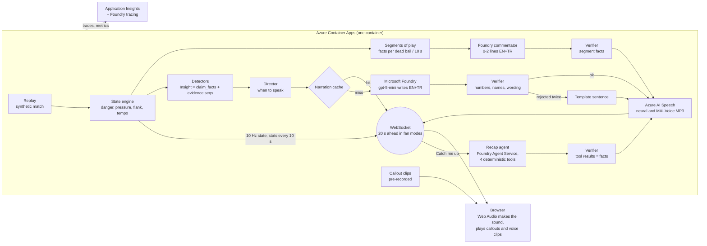

# Hear the Game

**Follow a football match by sound.**

[Live demo](https://ca-engine.proudflower-32a91b05.swedencentral.azurecontainerapps.io/) · Category: **Best Use of Microsoft Foundry** ([how Foundry is used](#microsoft-foundry))
<!-- After the video upload, add " · [Demo video (2 min)](https://youtu.be/...)" to the line above. -->

> **TL;DR** — A blind fan should be able to follow a match as it happens, not just hear the result.
> Hear the Game turns a live stream of match events into spatial sound on your device and short,
> verified commentary in English or Turkish. Built with **Microsoft Foundry** (gpt-5-mini),
> **Foundry Agent Service**, **Azure AI Speech** and **Container Apps**.

It is built for blind and partially sighted fans, and for anyone who can't look at a screen.
The README itself is written to be read with a screen reader: descriptive link text,
text alternatives for every image and diagram, and tables with headers.

> Built for the Microsoft × Premier League **Inside the Game** hackathon (October 2026).
> All clubs, players and matches are fictional and synthetic: a league of six clubs and six
> matches. The default match is **Northport** (red) v **Valemont** (blue).

---

<table>
<tr>
<td width="30%"></td>
<td></td>
</tr>
<tr>
<td>The listening view (phone), the first screen: made to follow a match without looking.</td>
<td>The broadcast desk (Highlights, Casual): pitch, evidence timeline, a verified recap and the live commentary feed.</td>
</tr>
</table>


## Table of contents

1. [Try it](#try-it)
2. [The problem](#the-problem)
3. [Experience a match](#experience-a-match)
4. [How it works](#how-it-works)
5. [Challenge fit](#challenge-fit)
6. [What you hear](#what-you-hear)
7. [Two views, one session](#two-views-one-session)
8. [Why you can trust it](#why-you-can-trust-it)
9. [Microsoft Foundry](#microsoft-foundry)
10. [Evidence](#evidence)
11. [What we learned](#what-we-learned)
12. [Built and not built](#built-and-not-built)
13. [Limitations](#limitations)
14. [Run it](#run-it)
15. [Overlay feed (machine-readable)](#overlay-feed-machine-readable)
16. [Repository layout](#repository-layout)
17. [License and attribution](#license-and-attribution)

---

## Try it

1. Open the [live demo](https://ca-engine.proudflower-32a91b05.swedencentral.azurecontainerapps.io/)
   with **headphones**: left and right carry information.
2. A first visit opens the **listening view**, made to be used without looking, including with
   VoiceOver. Press **Start listening** (or Space).
3. **Next moment** (N) jumps to 30 seconds before the next goal, saved shot or card.
   **Catch me up** gives a recap of the last 10 minutes.
4. **Show the pitch & data** (or open the [broadcast desk directly](https://ca-engine.proudflower-32a91b05.swedencentral.azurecontainerapps.io/?view=desk)) adds the pitch, the evidence timeline, the Why card and the three listening modes. Its
   header has the language switch; [open in Turkish](https://ca-engine.proudflower-32a91b05.swedencentral.azurecontainerapps.io/?lang=tr) (`?lang=tr`).

---

## The problem

Live audio description of football depends on trained human describers, so it exists for few
matches and few languages. A screen-reader score app gives the result, not the shape of the
game: who is pressing, which wing is under attack, whether a player is tiring.

Hear the Game gives that shape back by ear, in real time: you hear which side the ball is on, who
has it, how dangerous the attack is and what is changing tactically. It never says anything the
data does not support.

---

## Experience a match

Close your eyes. Press **Start listening**. Here is what you hear, in order, from the first
whistle:

1. **The pitch is laid out around you.** A soft ball tick, about eight a second, marks where
   the ball is: left or right, as the attacking team sees the pitch. Its pitch (high or low) says how
   dangerous the position is. Its timbre says which team has the ball. Its loudness says tempo.
2. **Pressure has a heartbeat.** As defenders close in on the ball carrier, a heartbeat starts
   and beats faster and louder.
3. **Events have their own sounds.** A pass is a soft click on the ball's side. A shot is a
   rising whoosh; a save is a thud; a foul or a ball out is a short whistle. A goal is a crowd
   swell, a rising four-note figure in the scorer's timbre, and a whistle.
4. **Your club and your player are marked.** Your club's goals get a longer, brighter swell;
   a goal against it is short and muted. Your player gets a two-note chime on the ball's side
   when they touch it (at most once every three seconds).
5. **A short sentence names the story.** When a tactical story is detected — a pressing surge,
   a tempo drop, a flank overload, a tiring player — one short sentence says it. Casual and
   Audio only hear a *fan* narrator; Analyst hears an *analyst* narrator with the numbers and
   the comparison. Goals cut through at once.
6. **In Casual and Audio only, a live commentator writes radio lines.** Play is cut into
   segments; each finished segment's facts go to Foundry, which writes 0–2 lines per language
   in one call. The Verifier checks them; a failing line is dropped, never replaced. Lines are
   played 20 seconds behind the server, so the voice stays in sync with the sound.
7. **Catch me up gives you the last 10 minutes.** At full time (and at half-time in
   Highlights) a recap plays by itself, written by the [Recap agent](#the-recap-agent) from
   your club's side.

Nothing here is a video with an audio track. The sound is made on your device from small state
packets, so it never waits for a model; only the voices travel as audio.

---

## How it works

1. **Events become sound, at once.** Match events stream to your browser, which turns them
   into spatial sound itself. No model sits in this path.
2. **Facts become verified words.** Code computes every number; Microsoft Foundry turns the
   facts into a sentence; a Verifier rejects any number or name that is not in the facts;
   Azure AI Speech voices it.
3. **You choose how to follow.** Listening view or broadcast desk; Audio only, Casual or
   Analyst; your club and your player; English or Turkish; Live or Highlights.




<details>
<summary><b>Text description of the architecture diagram</b></summary>

The server runs in a single Azure Container App. A synthetic match is replayed through a state
engine that computes danger, pressure, flank and tempo at 10 Hz and streams state packets over
a WebSocket. Detectors read the same state and produce Insights, each carrying `claim_facts`
and the evidence `seq` numbers it rests on. The Director decides when to speak. Narration goes
through a cache; on a miss it calls Microsoft Foundry (gpt-5-mini), which writes English and
Turkish sentences, then a deterministic Verifier checks numbers, names and wording. A rejected
draft goes back to the model once; a second failure falls back to a template sentence. The
accepted sentence is voiced by Azure AI Speech and pushed to the browser. Catch me up goes
through the Recap agent (Foundry Agent Service) with four deterministic tools; its tool results
are the facts the Verifier checks against. Live commentary runs the same Verifier per segment.
The browser synthesises all match sound itself with Web Audio; only voice clips travel as
audio. Traces and metrics go to Application Insights and Foundry tracing.

</details>

**Two speeds.** The fast path (replay → state → browser sound) is deterministic and never waits
for a model; the browser plays it through a fixed 300 ms jitter buffer. The slow path
(Insight → narration) runs in the background with a 4 s deadline: cache first, then Foundry +
Verifier + Speech. If it is late or fails, the listener gets the template sentence (read by the
browser's own voice) and the sound carries on. A narration that would arrive more than 8 s of
match time late is dropped (goals excepted).

---

## Challenge fit

How the app covers the pipeline in the Official Rules, section 4.1.

| Rules 4.1 | What Hear the Game does | See |
|---|---|---|
| Ingest (i a) | A timed match feed (a synthetic replay behind an `EventSource` adapter) becomes 10 Hz state: ball, danger, pressure, tempo | [How it works](#how-it-works) |
| Interpret (i b) | Detectors find pressing surges, tempo drops, flank overloads and tiring players, scored against hidden truth | [Evidence](#evidence) |
| Explain (i c) | Foundry writes each sentence from computed `claim_facts`; the Verifier rejects any number or name not in them | [Why you can trust it](#why-you-can-trust-it) |
| Render (i d) | Spatial sound made on the device, Azure AI Speech voices and captions, pitch and evidence timeline; the same data as timed JSON for overlays | [What you hear](#what-you-hear), [Overlay feed](#overlay-feed-machine-readable) |
| Personalize (i e) | Listening view or desk; Audio only / Casual / Analyst with a fan or an analyst narrator; favourite club and player; English or Turkish | [Two views](#two-views-one-session) |
| Match intelligence (ii) | Player names in callouts and commentary, shot speed and long-pass length in the event log, team stats every 10 s; no auto-eventing from video | [Two views](#two-views-one-session), [Built and not built](#built-and-not-built) |
| Narrative generation (iii) | Narration per Insight, a live commentator per segment of play, recaps written by an agent | [The Recap agent](#the-recap-agent) |
| Explainability (iv) | Every Insight carries its evidence `seq`s; the Why card shows its facts and lights its evidence on the pitch | [Two views](#two-views-one-session) |
| Data innovation (v) | A synthetic league calibrated on real open data, with hidden scenarios for honest scoring | [`docs/data.md`](docs/data.md) |
| Multi-language storytelling (vi) | English and Turkish text and voices from the same facts, each language checked by the Verifier | [Microsoft Foundry](#microsoft-foundry) |

---

## What you hear

The browser synthesises all match sound (Web Audio) from small state packets; only voice clips
travel as audio.

| Sound | What it tells you |
|---|---|
| **Ball tick**, about 8 a second while the ball is in play | **Pitch** = danger (a two-octave pentatonic scale driven by an Expected Threat model). **Left / right** = the flank, as the attacking team sees it. **Timbre** = which team has the ball. **Loudness** = tempo. |
| **Heartbeat** | Pressure on the ball carrier: it starts above a threshold and beats faster and louder as pressure rises. |
| **Crowd** | Filtered noise whose level follows danger. |
| **Event sounds** | Pass: a soft click on the ball's side. Shot: a rising whoosh. Save: a thud. Foul or ball out: a short whistle. Goal: a crowd swell, a rising four-note figure in the scorer's timbre, a whistle. Kick-off, half-time and full time have their own whistles. |
| **Your club** | Its goals get a longer, brighter swell; a goal against it is short and muted, with no fanfare. |
| **Your player** | A two-note chime on the ball's side when they touch it (at most every 3 s). |

A **60-second sound tour** plays each of these with a caption before the first start; it is
offered until done or skipped.

**Three voices.** Callouts and the commentator speak in an MAI-Voice commentary voice, the
narrator in a calmer neural voice. Other sound dips to 30% under the commentator and the
narrator.

- **Callouts** (Casual, Audio only): short pre-recorded clips strung together per event, no
  model involved.
- **Live commentator** (Casual, Audio only): play is cut into segments (a dead ball, or 10 s).
  Each finished segment's facts (who passed to whom, how far up the pitch, how it ended, score,
  card, shot speed) go to Foundry, which writes 0–2 radio lines in English and Turkish in one
  call. The Verifier checks them against those facts and a list of details no fact can carry
  (headers, the box, posts, penalties...). A goal's effect (takes the lead, equaliser, pulls
  one back) is computed and given as a fact, after an equaliser once came out as "Northport
  lead!". A failing line is dropped, never replaced. Lines are written live for every session;
  a verified line is also cached and plays as **fallback** if a later session's own line is
  late.
- **Narrator** (all modes): one short sentence when a tactical story is detected (a pressing
  surge, a tempo drop, a flank overload, a tiring player) and at every goal. Casual and Audio
  only hear a **fan**: radio tone, at most one number, at most 16 words ("Northport are
  pressing noticeably harder now, and Valemont are under more pressure."). Analyst hears an
  **analyst**: the key numbers and the comparison ("Northport press harder: 39% of Valemont's
  play is under pressure in the last 5 minutes, 22% earlier on."). Same facts, same Verifier.

**When the narrator speaks** (the Director, [`htg/engine/director.py`](htg/engine/director.py)):
goals at once; otherwise never during an attack (danger ≥ 0.15), never the same story for the
same team within 5 minutes, and only after a quiet spell that depends on the mode (Audio only
10 s, Analyst 15 s, Casual 25 s). Danger itself is left to the sound.

**Recaps.** **Catch me up** asks the [Recap agent](#the-recap-agent) for 2–3 verified sentences
about the last 10 minutes, told from your club's side. At full time (and at half-time in
Highlights) a recap plays by itself.

---

## Two views, one session

**Listening view** (the first screen) is made for blind and low-vision fans, and for anyone
listening rather than looking: a now-playing card (score, clock and the sentence being spoken),
**Start listening**, **Next moment**, **Catch me up**, Live / Highlights, and the six matches
in a list that is always open, so a screen reader swipes straight through it. Tapping a match
starts it; no card shows a final score. It plays in Audio only and speaks the device's language
(English or Turkish) unless one was chosen on the desk.

**Broadcast desk** (**Show the pitch & data**) runs the same session, so switching never stops
the sound; the last view is remembered on the device. It adds:

- **The pitch and an evidence timeline** of the whole match: known moments (goals, saved shots,
  cards) to jump to, and goals, shots and Insights in club colour as they happen. Every marker
  is a button with a screen-reader label.
- **The Why card**: select a spoken Insight to see its sentence, the `claim_facts` it was
  allowed to use, and its evidence lit up on the pitch (the events it rests on, the flank band,
  or a shot's line to goal).
- **The commentary feed** (Casual, Audio only): the commentator's lines with their minute and a
  live / fallback tag, shown as they are spoken.
- **Analyst**: a team stats table (possession, shots on target, pass completion, pressing,
  corners, fouls; whole match or last 10 minutes) from the same `get_stats` tool the Recap
  agent calls, so the two never disagree, and an event log with shot speed ("Shot · Arda ·
  72 km/h · blocked") and passes over 30 m.
- **Settings**: a favourite club (its matches are listed first, narration about it is tagged,
  and its Insights move up the narrator's queue) and a favourite player. The language switch in
  the header sets the screen and the commentary together.

**Live or Highlights**, both at normal speed (speech cannot be sped up, and sound at 2x loses
its meaning):

- **Live**: from kick-off, a chosen minute or a moment, to full time.
- **Highlights**: every moment back to back, each clip from 30 s before to 15 s after it, with
  a short transition and the half-time and full-time recaps in between: 10.7–12.3 minutes per
  match.

Every start is warmed up on everything before it, so the score and the tactical baselines are
already right.

---

## Why you can trust it

- **Numbers come from code, words from the model.** Detectors compute every number (shares,
  seconds, scores) and put it in `claim_facts`, with the event `seq` numbers it rests on. The
  model only turns those facts into one sentence per language.
- **The Verifier** ([`htg/narration/verifier.py`](htg/narration/verifier.py), plain Python)
  rejects a sentence that contains a number or a team or player name not in `claim_facts`,
  number words or multipliers ("twice"), causes or injuries, analyst jargon, internal code
  values (`off_target`), Turkish percent signs or suffixes on numbers (the voice misreads
  them), or more than 25 words. A rejected draft goes back to the model once with the reasons;
  if it fails again, the deterministic template sentence is used.
  **No unverified model text is spoken.**
- **Sound never waits.** Narration can fail completely and the match still sounds the same.
- **Reproducible demo.** The default match's narration (text and audio, both personas, three
  15-minute windows) is pre-generated and committed: same seed, same match, same sentences
  ([all 36 sentences](eval/results/demo_sentences.md)).

### What the Verifier cannot do

It checks numbers, names and wording, not meaning. Reading 100 model sentences per language by
hand (prompt 2) found an internal code value (`off_target`) read out in 13 of 200 sentences,
invented shot locations ("from the edge"), and a Turkish goal sentence that credited the wrong
team. Each became a rule: code values are rejected, the prompt allows only the facts, and goal
facts no longer name the opponent, so naming the wrong team fails the name check. A wrong
framing with no wrong number or name still passes: an early **Catch me up** once said "at the
break" at minute 9, and was fixed in the request to the agent. Details:
[`eval/results/narration.md`](eval/results/narration.md).

---

## Microsoft Foundry

Foundry is where the words are made, checked and measured:

- **Develop.** Prompt changes are measured, not guessed: prompts 3, 4 and 5 were compared with
  Foundry evaluations and the offline narration eval before shipping
  ([Evidence](#evidence)).
- **Orchestrate.** Per Insight, the narrator writes, the
  [Verifier](#why-you-can-trust-it) checks, one retry carries the reasons and the template is
  the fallback; the live commentator runs the same check per segment of play; the
  [Recap agent](#the-recap-agent) (Foundry Agent Service) chooses its own match tools.
- **Manage.** Foundry tracing in Application Insights shows each Insight's Verifier attempts
  and reasons on the deployed app; the evaluations are rerun for each new prompt.

Templates alone cannot write live radio lines, and a human describer covers one match in one
language. With Foundry, every listener of every match gets verified lines in English and
Turkish, p50 2.7 s after the play.

### The Recap agent

The one agent in the system. **Catch me up** and the full-time recap are written by a
**Foundry Agent Service prompt agent** (gpt-5-mini) with four function tools, run through the
Responses API ([`htg/recap/agent.py`](htg/recap/agent.py)). It decides which tools to call (at
most 4), then writes 2–3 sentences per language, in the fan or analyst persona, from your
club's side.

- **Tools are plain code** ([`htg/recap/tools.py`](htg/recap/tools.py)): `get_score`, `get_stats`,
  `get_insights` and `get_player`. They read the match **only up to the moment of the request**;
  tests check that nothing later leaks.
- **Verified like everything else.** The known facts are exactly the values the tools returned
  in this run. A rejected sentence goes back to the agent once with the reasons; one that still
  fails is dropped. A language with no surviving sentence, an error or a 25 s timeout gets the
  template recap (score, possession and shots, the latest goal).
- **Demo.** The demo match's full-time recaps (no favourite or either club × both personas,
  EN + TR, with audio) are pre-generated ([`recap_fulltime.md`](eval/results/recap_fulltime.md));
  **Catch me up** is always live.

Reporting seeds 11–30, 20 random moments in the second half
([`eval/results/recap.md`](eval/results/recap.md)):

| | EN | TR |
|---|---|---|
| Sentences passing the Verifier, first draft | 95% | 83% |
| ... after the one revision | 98% | 88% |
| Recaps that fell back to the template | 0% | 0% |

Mean 2.0 tool calls per recap (nearly always `get_score` and `get_stats`); latency without the
voice p50 6.06 s / p95 13.08 s, so the button says "Preparing…". Most Turkish rejections are a
suffix attached to a number. Reading the recaps by hand found what the Verifier cannot catch:
an unmeasured claim ("more of the play") passes because it has no number or name.

### Every service used

| Service | What it does here | Code |
|---|---|---|
| **Microsoft Foundry** (gpt-5-mini deployment) | Writes the EN + TR narration sentence from `claim_facts`, and the live commentator's 0–2 lines per segment | [`foundry.py`](htg/narration/foundry.py), [`commentator.py`](htg/commentary/commentator.py) |
| **Foundry Agent Service** (prompt agent, function tools, Responses API) | The Recap agent | [`agent.py`](htg/recap/agent.py) |
| **Foundry tracing** via Application Insights | One `htg.narrate_insight` span per Insight with Verifier attempts and reasons, the model call as a child span; one `htg.recap` span per recap with the tools used | [`telemetry.py`](htg/telemetry.py), [`service.py`](htg/narration/service.py) |
| **Foundry evaluations** | Groundedness and fluency of the shipped sentences | [`foundry_eval.py`](eval/foundry_eval.py) |
| **Azure AI Speech** | Narration: neural voices (en-GB, tr-TR) with SSML, goals a little faster and higher, Turkish numbers written out so they are read right. Commentator and callouts: MAI-Voice-2.1 (preview, `en-US-Ethan`) and MAI-Voice-2 (`tr-TR-Aydın`) with speaking styles, retried once with a neural voice on an error | [`azure.py`](htg/speech/azure.py), [`callouts.py`](htg/speech/callouts.py) |
| **Azure Container Apps** | One app: the static client and one replay session per listener over WebSocket | [`serve.py`](services/engine/serve.py), [`Dockerfile`](Dockerfile) |
| **Application Insights + Log Analytics** | Metrics: speech resolved by source (cache, llm, template), resolve time, stale drops, active sessions | [`app.bicep`](infra/app.bicep) |
| **Container Registry, managed identity** | Image pull and every Azure call without keys | [`app.bicep`](infra/app.bicep) |
| **azd + Bicep** | `azd up` provisions and deploys everything | [`azure.yaml`](azure.yaml), [`infra/`](infra/) |
| **GitHub Actions** | Lint, tests and a generator smoke test on every push | [`ci.yml`](.github/workflows/ci.yml) |

The detectors, the Director and the sound are deliberately plain code, not agents: they must
be fast, deterministic and testable. The one agent is the recap writer, where choosing what to
look up is the actual job; its tools are that same plain code.

---

## Evidence

Every number below comes from a file in [`eval/results/`](eval/results/). Detectors are tuned
on seeds 1–10 and reported on seeds 11–30.

**Detectors vs. hidden truth** (20 matches, [`scenarios.md`](eval/results/scenarios.md))

| Tactical story | Recall | Precision | Median delay |
|---|---|---|---|
| Pressing surge | 85% | 36% | 264 s |
| Tempo drop | 85% | 68% | 283 s |
| Flank overload | 40% | **11%** | 336 s |
| Player fatigue | 95% | 60% | 589 s |

The flank detector is weak: 89% of its Insights match no hidden scenario. That affects *which*
story is told, not the numbers in it: each sentence still states shares computed from the
events.

**Narration** (gpt-5-mini, reasoning effort `minimal`, [`narration.md`](eval/results/narration.md))

| | EN | TR |
|---|---|---|
| First draft passes the Verifier: prompt 4, 100 Insights | 100% | 100% |
| ... prompt 5 (shipping), fan / analyst, 50 Insights each | 100% / 98% | 96% / 100% |
| Fell back to the template | 0% | 0% |

- Latency per Insight (EN + TR in one call, retries included): **p50 1.58 s / p95 3.60 s**
  (prompt 4). The reasoning effort `minimal` makes this possible: on the same prompt, p50 fell
  from 10.73 s to 1.87 s. Azure TTS per clip: p50 0.56 s / p95 2.13 s.
- The two personas differ by design: 0.30 numbers per sentence for the fan, 1.08 for the
  analyst (EN).
- Verifier mutation test (synthetic errors injected into template sentences): **436 of 436
  caught**. It shows the checks fire, not how often a model errs.

**Live commentary** (8 windows, 119 match minutes: seed 7 from 0', 19' and 76', seeds 11–15
from 19'; every line generated live, English listener, prompt v4,
[`commentary.md`](eval/results/commentary.md))

| | Narration only | + callouts | + callouts + commentator |
|---|---|---|---|
| 30-s windows with any speech | 21% | 90% | **97%** |
| Longest silence, median per window / worst | 390 s / 605 s | 59 s / 84 s | **44 s / 66 s** |
| Share of time with speech | 4% | 9% | 33% |

- Commentator latency from the end of the play (model + Verifier + voice): **p50 2.71 s /
  p95 3.91 s** (max 10.05 s) against a 17 s budget (the 20 s delay minus a 3 s margin);
  0 of 469 calls went over.
- 2.8 lines heard per match minute; the model chose silence for 16% of segments.
- The Verifier dropped 22 lines in both languages, 36 in English only and 30 in Turkish only;
  the client dropped 30 because another voice held the slot for more than 3 s.
- Measured offline: the server's commentator stream on a simulated clock and the client's
  one-voice rules, simplified; narration and callout durations are estimates.

**Microsoft Foundry evaluation** (built-in evaluators, judge gpt-5-mini, shipping prompt 5,
50 Insights per persona × EN/TR, seeds 11–30, [`foundry_eval.md`](eval/results/foundry_eval.md))

| | Fan EN | Fan TR | Analyst EN | Analyst TR |
|---|---|---|---|---|
| Groundedness (1–5) | 4.72 | 4.66 | 4.92 | 4.92 |
| Fluency (1–5) | 3.08 | 3.28 | 3.14 | 3.40 |

Groundedness is the score that matters here: every number and name must come from the facts.
It is lower than the earlier prompt-3 run (4.99) mostly because fan lines write chances as two
exclamations ("Chance for Valemont! Okafor shoots…") or leave numbers out on purpose; 3 of 200
rows scored 2 (listed in the file). Fluency sits around 3 because a general-purpose judge
rewards complex sentences, and these are one-line radio calls: most reasons for a 3 cite
brevity. The judge is the same model family, and an LLM judge is weaker evidence in Turkish
than in English: read this as a second opinion next to the deterministic Verifier.

**Deployed latency** (Istanbul → Sweden Central, 4 listeners joining in the same second, the
most one client IP may open; 3 minutes each, 2026-10-26,
[`latency.md`](eval/results/latency.md))

| | Live, from kick-off | Highlights |
|---|---|---|
| Connect → first message | p50 2.2 s / p95 3.0 s | p50 2.0 s / p95 2.7 s |
| State packets (nominal every 200 ms) | p50 200 ms / p95 202 ms, longest gap 1.6 s | p50 200 ms / p95 202 ms, longest gap 2.4 s |
| Insight → speech delivered | p50 334 ms (4 sentences from the pre-generated cache, all with audio) | no Insight in these 3 minutes |

The longest Highlights gap is probably the cut between two clips. An earlier 10-listener run
showed a 13 s start because every listener re-ran the warm-up; the server now warms up once
and copies the result. Client audio output latency is not measured.

---

## What we learned

Building this in a hackathon surfaced three lessons that shaped the shipped product:

1. **A Verifier is necessary but not sufficient.** Deterministic checks catch numbers and
   names; they do not catch meaning. An early **Catch me up** said "at the break" at minute 9,
   and an early Turkish goal sentence credited the wrong team. Both were fixed — one in the
   agent request, one by not naming the opponent in goal facts — but they show why a
   deterministic check must be paired with reading real output by hand.
2. **Latency is a product decision.** Setting the model's reasoning effort to `minimal` cut
   narration latency on the same prompt from p50 10.73 s to 1.87 s (prompt 2: 7.71 s to 1.58 s).
   Against a 4 s deadline, that one setting is the difference between "usable in real time" and
   "not". Templates cannot do what the model does; at the default setting the model cannot do
   it fast enough.
3. **Honest metrics build trust.** Publishing the flank detector's 11% precision felt risky,
   but it makes every other number in this README more credible — and it points at exactly
   where the next week of work would go.

---

## Built and not built

**Built:** everything above, on one Azure Container App, with a synthetic replay as the event
source.

**Not built** (the production path, described only):

- Real data feeds through **Event Hubs**, fan-out through **Web PubSub**, an Insight log in
  **Cosmos DB**, a shared clip cache in **Blob Storage**. The code keeps the seams
  (`EventSource`, `Broadcaster` and `Speech` adapters with local implementations); none of
  these services is used.
- Auto-eventing from video: the events come from the synthetic replay.
- Languages beyond English and Turkish: each needs its own Verifier rules, templates and
  voices.
- Lock-screen and headphone controls (Media Session API): on iOS they need a media element;
  the next step.

---

## Limitations

- **Synthetic data only.** The matches are generated and calibrated on real open data
  ([`docs/data.md`](docs/data.md)); no real feed has been connected.
- **Only the default match is pre-generated** (narration for three 15-minute windows, both
  personas, every favourite club; full-time recaps). Everything else is narrated live: a cache
  miss calls Foundry and Speech within a 4 s deadline, and the slowest fall back to the
  template sentence.
- **The commentator depends on the 20 s delay** and on MAI-Voice, which is in public preview
  (no SLA). A late or failed line falls back to the line an earlier session cached for that
  segment, or to the callouts alone; the sound never waits.
- **Tactical detection is slow and uneven:** a trend needs minutes of play (median delay
  264–589 s), and the flank detector's precision is 11%.
- **Recaps take seconds** (p50 6 s before the voice), and Turkish recap sentences pass the
  Verifier less often (88% vs 98%); a dropped sentence makes a recap shorter, not wrong.
- **Not tested with blind users.** The author tried the listening view with VoiceOver on one
  iPhone, where background audio also kept playing in Safari with the screen locked
  The layout was checked in headless Chrome at phone and desktop widths. A
  listening-test protocol with an answer key is ready:
  [`docs/listening-test.md`](docs/listening-test.md).
- **Public demo limits:** one recap per listener at a time with a 20 s cooldown; at most 4
  open sessions per client IP and 20 per replica (counted per replica, up to 2 replicas). A
  hidden tab stops 2 minutes after the browser suspends its sound, and after 45 minutes in any
  case, so a forgotten tab does not call Foundry for a whole match.

---

## Run it

```bash
python3 -m venv .venv && source .venv/bin/activate        # Python 3.11+
pip install -e ".[dev]"
ruff check . && pytest
python -m services.engine.serve --port 8000              # open http://localhost:8000
```

Without Azure everything still runs: narration uses the template sentences and the browser's
own voice, the pre-recorded callouts play, and there is no live commentator.

<details>
<summary><b>With Microsoft Foundry and Azure AI Speech: pre-generation, evaluations, deploy</b></summary>

`pip install -e ".[azure]"`, `az login`, copy `.env.example` to `.env` and fill in the Foundry
project endpoint, the model and the Speech endpoint, then run with `HTG_ENV=azure`.

```bash
HTG_ENV=azure python -m htg.narration.pregen --seed 7         # default-match narration + clips
HTG_ENV=azure python -m htg.recap.pregen --seed 7             # full-time recaps + clips
HTG_ENV=azure python -m htg.speech.tour                       # sound-tour voice lines (web/tour.json)
HTG_ENV=azure python -m htg.speech.callouts                   # callout clips in the commentary voice
HTG_ENV=azure python -m eval.narration --seeds 11-30 --limit 100 --samples eval/results/narration_samples.jsonl  # --persona fan|analyst
HTG_ENV=azure python -m eval.recap --seeds 11-30 --n 20       # Recap agent: Verifier, fallback, tools, latency
HTG_ENV=azure python -m eval.commentary                       # live commentary: speech coverage, latency, drops
python -m eval.foundry_eval                                   # Foundry evaluation of the narration samples
python -m eval.scenarios                                      # detectors vs. hidden truth
python -m eval.latency --url wss://<your-app>/ws --sessions 4 --minutes 3 --watch live   # or --watch highlights
```

**Deploy:** `azd up` (Bicep in [`infra/`](infra/)). The app's managed identity needs
*Cognitive Services User*, *Azure AI Developer* and *Cognitive Services OpenAI User* on the
Foundry (AI Services) resource; these were added by hand. `minReplicas` is 1 for judging; set
it to 0 afterwards to save cost.

</details>

---

## Overlay feed (machine-readable)

Everything the browser receives is timed JSON over one WebSocket
(`/ws?match=<id>&mode=live&from=<seconds>`, or `mode=highlights`; fixtures with their moments
and clips are at `/matches.json`). Every message carries match time `t` in seconds; payload
schemas are in [`schemas/`](schemas/). The same feed could drive a broadcast graphics engine;
no such integration exists.

<details>
<summary><b>Messages and a real example</b></summary>

| Message | Content |
|---|---|
| `hello` | the match: teams (club, names EN/TR, colour, players), score at the start, `watch`, `duration_s`, the `windows` the session plays, every goal, saved shot and card as `moments`, and the `history` before the start |
| `cut` | Highlights: the clip ends at `t_from` and the next starts at `t_to`, with the score at `t_to` and the history in between |
| `state` | 10 Hz: ball position, team, danger (xT), pressure, pan, tempo ([schema](schemas/state.schema.json)) |
| `event_cue` | pass, shot, save, goal, whistle, period end: team, player, period, event `seq`; shot position, `speed_mps`, `outcome`, pass `length_m` |
| `insight` | a detected tactical story: `claim_facts` (every number in it) and `evidence` (event `seq`s) ([schema](schemas/insight.schema.json)), the template `text`, `evidence_points` and the flank `zone` |
| `stats` | every 10 s, per team: possession, shots (on target), pass completion, pressing, corners, fouls, for the match so far and the last 10 minutes |
| `speech` | the Insight told now: EN + TR text, `source` (`llm` verified, or `template`), persona, MP3 per language |
| `commentary` | a live commentator line: EN + TR text, `source` (`live` or `fallback`), `latency_s`, style, MP3 in the listener's language |
| `recap` | `kind` `missed`, `half_time` (Highlights) or `full_time`: 2–3 sentences per language, `source` (`agent` or `template`), MP3 per language |

The listener sends back `set_mode`, `set_favourite`, `set_lang` and `recap_request`.

Real messages from seed 7, the first goal (audio trimmed):

```json
{"type": "insight", "insight": {"insight_id": "synth_0007:goal:A09:1358", "match_id": "synth_0007", "t": 1358.39, "type": "goal",
 "team": "AWAY", "player_id": "A09", "claim_facts": {"team_en": "Valemont", "team_tr": "Valemont", "player": "Baptiste",
 "home_score": 0, "away_score": 1}, "evidence": [561, 562], "confidence": 1.0, "priority": 5, "expires_at": 1418.39},
 "text": {"en": "Goal! Baptiste scores for Valemont. It is now 0-1.", "tr": "Gol! Baptiste Valemont için attı. Skor 0-1."},
 "evidence_points": [{"seq": 561, "t": 1357.98, "type": "shot", "team": "AWAY", "x": 5.6, "y": 27.97},
                     {"seq": 562, "t": 1358.39, "type": "goal", "team": "AWAY", "x": 0.0, "y": 36.53}], "zone": null}

{"type": "speech", "t": 1358.4, "insight_id": "synth_0007:goal:A09:1358", "priority": 5, "team": "AWAY", "persona": "fan",
 "evidence": [561, 562], "text": {"en": "Goal! Baptiste gives Valemont the lead, and it's 0-1!",
 "tr": "Gol! Baptiste Valemont için ağları sarsıyor, skor 0-1!"}, "source": {"en": "llm", "tr": "llm"},
 "audio": {"en": "//NkxAAAAANI…", "tr": "//NkxAAaC1IE…"}, "duration_s": {"en": 4.2, "tr": 5.3}}
```

</details>

---

## Repository layout

```
schemas/     JSON schemas: event, state, insight, cue (the contracts between layers)
htg/         calibration, generator, replay, state engine, detectors, Director, narration, Verifier, recap agent, speech, telemetry
services/    the server (WebSocket sessions, live commentary, recaps) and a local runner
web/         the single-page client (vanilla JS, Web Audio)
eval/        scoring scripts and results/ (every number in this README)
infra/       Bicep for azd
data/        calibration aggregates, synthetic matches, the demo narration, recap, callout and sound-tour caches
docs/        data generation, listening-test protocol, submission texts, status
```

---

## License and attribution

Code: [MIT](LICENSE). Calibration uses data provided by **StatsBomb** (Hudl) under the
[StatsBomb Open Data terms](https://github.com/hudl/open-data) and SkillCorner Open Data (MIT);
only aggregates are published. Clubs, players and matches are fictional; no real club, player
or league branding is used.
