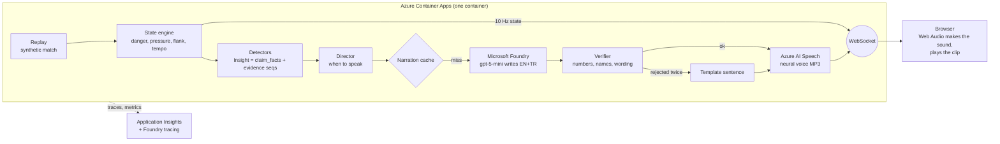

# Hear the Game

**Follow a football match with your eyes closed.** Hear the Game turns a live stream of match events into spatial sound made on
your own device, plus short, verified narration in English or Turkish, so blind and partially sighted fans (and anyone who can't
look at a screen) can follow the shape of a match as it happens.

> Built for the Microsoft × Premier League **Inside the Game** hackathon (October 2026), category **Best Use of Microsoft Foundry**.
> All teams, players and matches are fictional and synthetic.

## The problem

Live audio-described commentary for blind and partially sighted fans depends on trained human describers, so it exists for
few matches and few languages. A screen-reader score app tells you the result, not the shape of the game: who is pressing, which
wing is being attacked, whether a player is tiring. Hear the Game tries to give that shape back, by ear, in real time, and to never
say anything the data does not support.

## What you hear

The browser synthesises all match sound itself (Web Audio) from small state packets. Nothing but narration clips is sent as audio.

| Sound | What it means |
|---|---|
| **Ball tick** (about 8 per second, only while the ball is in play) | **Pitch** = danger: higher notes as the ball gets more dangerous (two-octave pentatonic scale driven by an Expected Threat model). **Left/right** = the flank as the attacking team sees it. **Timbre** = which team has the ball (two different waveforms). **Loudness** = tempo. |
| **Heartbeat** (low thump) | Pressure on the ball carrier: starts above a threshold, beats faster and louder as pressure rises. |
| **Crowd** | Filtered noise whose level follows danger. |
| **Event sounds** | Pass: soft click on the ball's side. Shot: rising whoosh. Save: thud. Out or foul: short whistle. Kick-off: long whistle. Goal: crowd swell, a rising four-note figure in the scoring team's timbre, whistle. |
| **Favourite player** | Pick a player; a two-note chime plays on the ball's side when they touch it (at most every 3 s). |
| **Narration** | One short sentence (Azure neural voice, EN or TR) when something tactical is detected. Other sound dips to 30% under the voice. The caption shows **verified** (model text that passed the Verifier) or **template** (fallback). |

**When the narrator speaks** (the Director, `htg/engine/director.py`): goals immediately; otherwise never during an attack
(danger ≥ 0.15), never the same kind of Insight for the same team within 5 minutes, one sentence at a time, and only after a
mode-dependent silence (Audio only 10 s, Analyst 15 s, Casual 25 s). Moments of danger are left to the sound: they are not
narrated. **What did I miss?** reads the score and the last three sentences. Interface and narration are in **Turkish or English**.

## Architecture



**Two speeds.** The fast path (replay → state → browser sound) is deterministic and never waits for a model; the browser plays it
through a fixed 300 ms jitter buffer. The slow path (Insight → narration) runs in the background with a 4 s deadline: cache first,
then Foundry + Verifier + Speech; if it is late or fails, the listener gets the template text (read by the browser's own voice)
and the sound carries on. A narration
that would arrive more than 8 s of match time late is dropped (goals excepted).

## Why you can trust it

- **Numbers come from code, words from the model.** Detectors compute every number (shares, seconds, scores) and put it in
  `claim_facts`, with the event `seq` numbers it rests on. The model only turns those facts into one sentence per language.
- **The Verifier** (`htg/narration/verifier.py`, plain Python) rejects a sentence that contains a number or a team/player name not in
  `claim_facts`, number words or multipliers ("twice"), causes or injuries, analyst jargon, internal code values (`off_target`),
  Turkish percent signs or suffixes on numbers (the voice misreads them), or more than 25 words. A rejected draft goes back to the
  model once with the reasons; if it fails again, the deterministic **template** sentence is used. No unverified model text is spoken.
- **Sound never waits.** Narration can fail completely and the match still sounds the same.
- **Reproducible demo.** The demo match's narration (text + audio) is pre-generated and committed, so the demo does not depend on
  live model latency. Same seed, same match, same sentences.

**What the Verifier cannot do**, and how we found out: it checks numbers, names and wording, not meaning. Reading 100 model
sentences by hand (prompt 2) found an `off_target` read out in 13 of 200 sentences, invented shot locations ("from the edge"), and
one demo goal where the Turkish sentence credited the score to the wrong team ("skor 0-1 Kırmızılar lehine" for a Blues goal). Each
became a rule: code values are rejected, the prompt says to use only the facts, and goal facts no longer contain the opponent's
name, so naming the wrong team fails the name check. Invented details without a number or a name are still not caught
deterministically. Details: [`eval/results/narration.md`](eval/results/narration.md).

## Evidence

All numbers below come from files in this repository; detectors are tuned on seeds 1-10 and reported on seeds 11-30.

**Detectors vs. hidden truth** (20 matches, [`eval/results/scenarios.md`](eval/results/scenarios.md))

| Tactical story | Recall | Precision | Median delay |
|---|---|---|---|
| Pressing surge | 85% | 36% | 264 s |
| Tempo drop | 85% | 68% | 283 s |
| Flank overload | 40% | **11%** | 336 s |
| Player fatigue | 95% | 60% | 589 s |

The flank detector is weak: 89% of its flank Insights do not match a hidden scenario. That affects *which* tactical story is told,
not the correctness of the numbers in it: each sentence still states shares that were computed from the events.

**Narration** (100 Insights, gpt-5-mini, reasoning effort `minimal`, prompt 4, [`eval/results/narration.md`](eval/results/narration.md))

| | EN | TR |
|---|---|---|
| Passed the Verifier on the first draft | 100% | 100% |
| Fell back to the template | 0% | 0% |

- Real Verifier rejections in this run: **0 of 200** sentences. The rules above came from reading samples, not from rejections.
- Verifier mutation test (synthetic errors injected into template sentences): **436 of 436 caught**; this shows the checks fire,
  not how often a model errs.
- Narration latency per Insight (EN + TR in one call): **p50 1.58 s / p95 3.60 s**, down from 10.73 s / 17.42 s before setting
  the reasoning effort to `minimal` (both measured, dated history in the file). Azure TTS per clip: p50 0.56 s / p95 2.13 s.

**Microsoft Foundry evaluation** (built-in evaluators, judge gpt-5-mini, 100 Insights × EN/TR, prompt-3 sentences,
[`eval/results/foundry_eval.md`](eval/results/foundry_eval.md))

| | EN | TR |
|---|---|---|
| Groundedness (1-5) | 4.99 | 4.99 |
| Fluency (1-5) | 3.13 | 3.48 |

Fluency sits at 3-4 because the rubric rewards complex sentences; 136 of the 139 reasons for a 3 cite brevity, which is what a
one-sentence radio line is. The judge is the same model family, and an LLM judge on Turkish is weaker evidence than on English: read
this as a second opinion next to the deterministic Verifier.

**Deployed latency** (Istanbul → Sweden Central, measured from outside, [`eval/results/latency.md`](eval/results/latency.md))

| | 1 listener | 10 listeners joining in the same second |
|---|---|---|
| Connect → first message | 1.5 s | p50 3.8 s / p95 6.5 s |
| State packets (nominal every 200 ms) | p50 200 ms / p95 214 ms | p50 200 ms / p95 237 ms, longest gap 3.4 s |
| Speech decided → delivered | 224 ms | p50 1.4 s / p95 3.4 s |

The first 10-listener run showed a 13 s start and a 15.8 s stall: every listener re-ran a 13-minute warm-up on the shared CPU. The
server now warms up once and copies the result per listener; the table shows the run after that fix. Client audio output latency is
not measured.

## Microsoft stack

| Service | What it does here | Where |
|---|---|---|
| **Microsoft Foundry** (model deployment, gpt-5-mini) | Writes the EN + TR sentence from `claim_facts` | [`htg/narration/foundry.py`](htg/narration/foundry.py) |
| **Foundry tracing** via Application Insights | One `htg.narrate_insight` span per Insight with Verifier attempts and reasons; the model call as a child span (prompt and output content configured on the span) | [`htg/telemetry.py`](htg/telemetry.py), [`htg/narration/service.py`](htg/narration/service.py) |
| **Foundry evaluations** | Groundedness and fluency of the shipped sentences | [`eval/foundry_eval.py`](eval/foundry_eval.py) |
| **Azure AI Speech** | Neural voices (en-GB, tr-TR), SSML: faster and higher for goals, Turkish numbers spoken from words | [`htg/speech/azure.py`](htg/speech/azure.py) |
| **Azure Container Apps** | One app: static client, health check, one replay session per listener over WebSocket | [`services/engine/serve.py`](services/engine/serve.py), [`Dockerfile`](Dockerfile) |
| **Application Insights + Log Analytics** | Metrics `htg.speech.resolved` (cache / llm / template), `htg.speech.resolve_ms`, `htg.speech.dropped_stale`, `htg.sessions.active` | [`infra/app.bicep`](infra/app.bicep) |
| **Container Registry, managed identity** | Image pull and all Azure calls without keys (user-assigned identity) | [`infra/app.bicep`](infra/app.bicep) |
| **azd + Bicep** | `azd up` provisions and deploys everything | [`azure.yaml`](azure.yaml), [`infra/`](infra/) |
| **GitHub Actions** | Lint, tests and a generator smoke test on every push | [`.github/workflows/ci.yml`](.github/workflows/ci.yml) |

The detectors, the Director and the sound are deliberately plain code, not agents: they must be fast, deterministic and testable.

## Built vs. not built

Built: everything above, running on one Container App with a synthetic replay as the event source.

**Not built** (the production path, described only): real data feeds ingested through **Event Hubs**, fan-out to many listeners
through **Web PubSub**, an Insight log in **Cosmos DB**, a shared clip cache in **Blob Storage**. The code keeps the seams for them
(`EventSource`, `Broadcaster` and `Speech` adapters with local implementations), but none of these services are used.

## Limitations

- **Synthetic data only.** The matches are generated (calibrated on real open data, see [`docs/data.md`](docs/data.md)); no real
  feed has been connected.
- **The demo narration is pre-generated.** A live cache miss (for example in Analyst mode) calls Foundry and Speech within a 4 s
  deadline; at the measured p95 of 3.60 s for the text plus TTS, the slowest misses fall back to the template sentence.
- **The flank detector** has 11% precision (see above).
- **Detection delay** is minutes, not seconds (median 264-589 s): tactical trends need a window of play before they are real.
- **iOS background audio** is untested. The layout was checked in headless Chrome at phone and desktop widths, not on many real phones.
- **Accessibility** was checked by the author with VoiceOver. It has **not been validated with blind users**. A listening-test
  protocol with an answer key is in [`docs/listening-test.md`](docs/listening-test.md); it has not been run yet.

## Run it

```bash
python3 -m venv .venv && source .venv/bin/activate        # Python 3.11+
pip install -e ".[dev]"
ruff check . && pytest
python -m services.engine.serve --seed 7 --start-minute 13 --port 8000   # open http://localhost:8000
```

Without Azure everything still runs: narration uses the template sentences and the browser's own voice.

**With Microsoft Foundry and Azure AI Speech:** `pip install -e ".[azure]"`, `az login`, copy `.env.example` to `.env` and fill in
the Foundry project endpoint, model and Speech endpoint, then run with `HTG_ENV=azure`.

```bash
HTG_ENV=azure python -m htg.narration.pregen --seed 7                        # pre-generate the demo narration + clips
HTG_ENV=azure python -m eval.narration --seeds 11-30 --limit 100 --samples eval/results/narration_samples.jsonl
python -m eval.foundry_eval                                                    # Foundry evaluation of those samples
python -m eval.latency --url wss://<your-app>/ws --sessions 10 --minutes 3      # deployed latency
python -m eval.scenarios                                                       # detectors vs. hidden truth
```

**Deploy:** `azd up` (Bicep in [`infra/`](infra/)). The app's managed identity needs these roles on the Foundry (AI Services)
resource: *Cognitive Services User*, *Azure AI Developer* and *Cognitive Services OpenAI User*. These were added by hand.
`minReplicas` is 1 for judging; set it to 0 afterwards to save cost.

## Repository layout

```
schemas/     JSON schemas: event, state, insight, cue (the contracts between layers)
htg/         calibration, generator, replay, state engine, detectors, Director, narration, Verifier, speech, telemetry
services/    the server (serve.py) and a local runner
web/         the single-page client (vanilla JS, Web Audio)
eval/        scoring scripts and results/ (every number in this README)
infra/       Bicep for azd
data/        calibration aggregates, synthetic matches, the demo narration cache
docs/        data generation, listening-test protocol, status
```

## License and attribution

Code: [MIT](LICENSE). Calibration uses data provided by **StatsBomb** (Hudl) under the
[StatsBomb Open Data terms](https://github.com/hudl/open-data) and SkillCorner Open Data (MIT); only aggregates are published.
Teams, players and matches are fictional; no real club, player or league branding is used.
